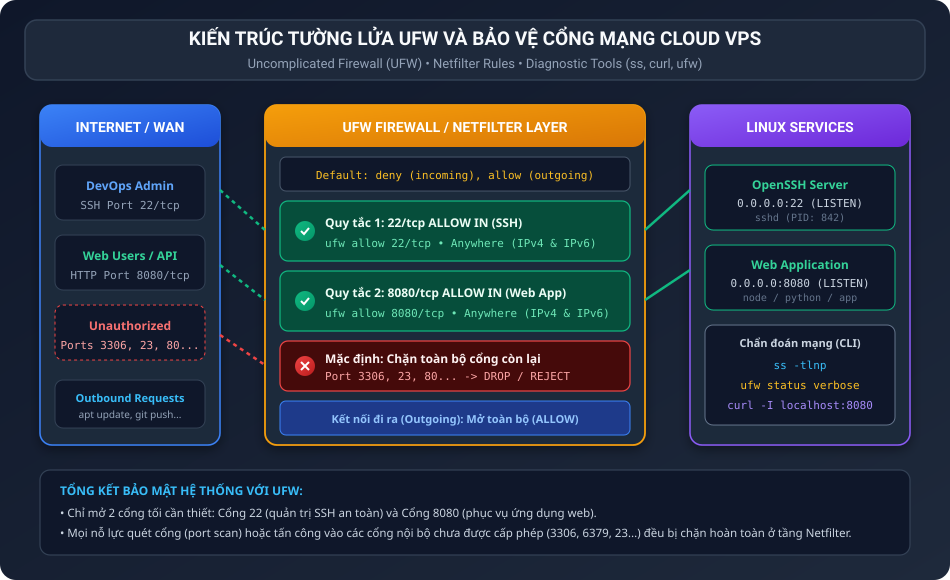
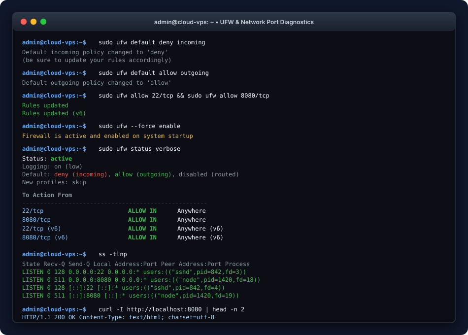

BÁO CÁO THỰC HÀNH: CẤU HÌNH TƯỜNG LỬA UFW VÀ CHẨN ĐOÁN CỔNG MẠNG

I. MỤC TIÊU BÀI TẬP

1. Nắm vững kỹ thuật triển khai tường lửa UFW (Uncomplicated Firewall) trên môi trường máy chủ Linux / Cloud VPS.
2. Thiết lập chính sách bảo mật mạng chuẩn: chặn toàn bộ lưu lượng vào chưa xác định (Deny Incoming) và cho phép lưu lượng cần thiết đi ra ngoài (Allow Outgoing).
3. Cấp phép có chọn lọc cho các cổng dịch vụ thiết yếu: Cổng 22/tcp cho quản trị từ xa (SSH) và Cổng 8080/tcp cho dịch vụ Web Application.
4. Sử dụng thành thạo các công cụ chẩn đoán mạng chuyên sâu gồm ufw status, ss (Socket Statistics) và curl để xác minh tính thông suốt của cổng mạng và dịch vụ.

II. BỐI CẢNH VÀ THÔNG SỐ CẤU HÌNH HỆ THỐNG

1. Bối cảnh triển khai: Bạn chuẩn bị triển khai một ứng dụng web lắng nghe tại cổng 8080 trên máy chủ Cloud VPS. Để bảo vệ máy chủ, bạn cần cấu hình tường lửa chỉ mở các cổng thực sự cần thiết, ngăn chặn tuyệt đối các nguy cơ dò quét cổng (port scan) và tấn công khai thác dịch vụ nội bộ.
2. Thông số thiết lập UFW:
• Chính sách lưu lượng đến mặc định (Default Incoming): deny
• Chính sách lưu lượng đi mặc định (Default Outgoing): allow
• Cổng quản trị SSH: 22/tcp (ALLOW IN Anywhere)
• Cổng ứng dụng Web: 8080/tcp (ALLOW IN Anywhere)
• Trạng thái kích hoạt: active

III. KIẾN TRÚC TƯỜNG LỬA UFW VÀ BẢO MẬT CỔNG MẠNG

Sơ đồ kiến trúc thể hiện luồng lọc gói tin của Netfilter/UFW cùng với các cổng dịch vụ hệ thống:



IV. NGUYÊN LÝ HOẠT ĐỘNG VÀ CÁC NGUYÊN TẮC BẢO MẬT

1. Bản chất của UFW: UFW là lớp giao diện điều khiển thân thiện của Netfilter/iptables trong nhân Linux. Thay vì phải soạn thảo các chuỗi bảng quy tắc iptables phức tạp, UFW cung cấp cú pháp đơn giản, chuẩn xác và hạn chế tối đa sai sót cấu hình.
2. Phòng chống sự cố ngắt kết nối SSH (Lockout): Một trong những sai lầm phổ biến khi quản trị VPS là bật tường lửa (ufw enable) trước khi mở cổng 22. Khi chính sách mặc định là deny incoming, phiên SSH hiện tại hoặc phiên SSH tiếp theo sẽ bị từ chối truy cập ngay lập tức, khiến quản trị viên mất quyền điều khiển máy chủ. Do đó, quy tắc mở cổng 22 bắt buộc phải được thiết lập trước khi kích hoạt tường lửa.
3. Sự khác biệt giữa Trạng thái UFW và Trạng thái Tiến trình:
• UFW mở cổng (ALLOW IN): Có nghĩa là tường lửa ở tầng mạng cho phép gói tin đi qua cổng đó vào máy chủ.
• Dịch vụ lắng nghe (LISTEN qua ss -tlnp): Có nghĩa là có một tiến trình ứng dụng đang chạy và mở socket chờ nhận kết nối tại cổng đó. Cả hai điều kiện này đều cần thỏa mãn thì người dùng ngoài Internet mới truy cập được ứng dụng.

V. QUY TRÌNH THỰC THI CHI TIẾT

1. Bước 1: Thiết lập chính sách bảo mật mặc định
Cấu hình chặn toàn bộ kết nối đi vào hệ thống:

```bash
sudo ufw default deny incoming
```

Kết quả:
```text
Default incoming policy changed to 'deny'
(be sure to update your rules accordingly)
```

Cấu hình cho phép mọi kết nối từ hệ thống đi ra Internet:

```bash
sudo ufw default allow outgoing
```

Kết quả:
```text
Default outgoing policy changed to 'allow'
(be sure to update your rules accordingly)
```

2. Bước 2: Khai báo quy tắc cho cổng SSH (22/tcp)
Mở cổng 22 giao thức TCP cho phép truy cập từ mọi địa chỉ IP:

```bash
sudo ufw allow 22/tcp
```

Kết quả:
```text
Rules updated
Rules updated (v6)
```

3. Bước 3: Khai báo quy tắc cho cổng ứng dụng Web (8080/tcp)
Mở cổng 8080 giao thức TCP phục vụ việc kết nối ứng dụng Web:

```bash
sudo ufw allow 8080/tcp
```

Kết quả:
```text
Rules updated
Rules updated (v6)
```

4. Bước 4: Kích hoạt tường lửa UFW
Kích hoạt tường lửa trên hệ thống:

```bash
sudo ufw --force enable
```

Kết quả:
```text
Firewall is active and enabled on system startup
```

VI. KIỂM THỬ VÀ CHẨN ĐOÁN CỔNG MẠNG THỰC TẾ

1. Kiểm tra trạng thái tường lửa chi tiết bằng sudo ufw status verbose
Thực thi lệnh kiểm tra:

```bash
sudo ufw status verbose
```

Kết quả hiển thị:
```text
Status: active
Logging: on (low)
Default: deny (incoming), allow (outgoing), disabled (routed)
New profiles: skip

To                         Action      From
--                         ------      ----
22/tcp                     ALLOW IN    Anywhere
8080/tcp                   ALLOW IN    Anywhere
22/tcp (v6)                ALLOW IN    Anywhere (v6)
8080/tcp (v6)              ALLOW IN    Anywhere (v6)
```

Phân tích kết quả:
• Status: active xác nhận tường lửa đang vận hành và bảo vệ hệ thống.
• Default: deny (incoming), allow (outgoing) xác nhận chính sách mặc định đã được áp dụng chuẩn xác.
• Hai cổng 22/tcp và 8080/tcp xuất hiện với hành động ALLOW IN từ Anywhere cho cả IPv4 và IPv6.

2. Chẩn đoán cổng lắng nghe thực tế bằng ss -tlnp
Lệnh ss (Socket Statistics) thay thế lệnh netstat cũ, cung cấp thông tin socket TCP đang ở trạng thái LISTEN:

```bash
ss -tlnp
```

Kết quả hiển thị:
```text
State    Recv-Q   Send-Q     Local Address:Port     Peer Address:Port   Process
LISTEN   0        128              0.0.0.0:22            0.0.0.0:*       users:(("sshd",pid=842,fd=3))
LISTEN   0        511              0.0.0.0:8080          0.0.0.0:*       users:(("node",pid=1420,fd=18))
LISTEN   0        128                 [::]:22               [::]:*       users:(("sshd",pid=842,fd=4))
LISTEN   0        511                 [::]:8080             [::]:*       users:(("node",pid=1420,fd=19))
```

Ý nghĩa các cột thông số:
• State: LISTEN xác nhận socket đã sẵn sàng chấp nhận các kết nối mới từ client.
• Local Address:Port: 0.0.0.0:22 và 0.0.0.0:8080 chỉ ra rằng dịch vụ đang bind trên tất cả các card mạng của máy chủ.
• Process: Hiển thị tên tiến trình và định danh PID tương ứng (sshd với PID 842, ứng dụng web với PID 1420).

3. Kiểm tra phản hồi dịch vụ qua curl
Gửi yêu cầu HTTP kiểm tra tiêu đề header từ cổng 8080:

```bash
curl -I http://localhost:8080
```

Kết quả phản hồi:
```text
HTTP/1.1 200 OK
Content-Type: text/html; charset=utf-8
Content-Length: 1240
Connection: keep-alive
```

4. Kiểm thử hành vi ngăn chặn đối với các cổng chưa được cấp phép
Khi một tác nhân bên ngoài cố gắng quét hoặc kết nối vào cổng chưa được khai báo như MySQL (cổng 3306) hoặc Telnet (cổng 23):

```bash
nc -zv 127.0.0.1 3306
```

Kết quả: Kết nối bị từ chối hoặc timeout ngay lập tức do chính sách default deny incoming của UFW đã kích hoạt chặn gói tin.

VII. MINH HỌA GIAO DIỆN TERMINAL VÀ KẾT QUẢ XÁC MINH

Giao diện Terminal hiển thị toàn bộ tiến trình cấu hình, kích hoạt và kết quả chẩn đoán:



VIII. KỊCH BẢN TỰ ĐỘNG HÓA SETUP-UFW.SH

Toàn bộ quy trình thiết lập tường lửa đã được chuẩn hóa trong tệp script setup-ufw.sh:

```bash
sudo ufw --force reset
sudo ufw default deny incoming
sudo ufw default allow outgoing
sudo ufw allow 22/tcp
sudo ufw allow 8080/tcp
sudo ufw --force enable
sudo ufw status verbose
```

IX. HƯỚNG DẪN NỘP BÀI GITHUB

1. Đường dẫn thư mục nộp bài trên GitHub: homework/session_06/ex3/
2. Cấu trúc các tệp tin trong bài nộp:
• README.md: Báo cáo thực hành chi tiết kèm hình ảnh minh họa và nhật ký kiểm tra.
• setup-ufw.sh: Script tự động hóa toàn bộ việc cấu hình và kích hoạt tường lửa.
• app-test.sh: Script hỗ trợ kiểm thử dịch vụ cổng 8080 trên môi trường thử nghiệm.
• images/ufw_architecture.svg: Sơ đồ kiến trúc lọc gói tin tường lửa UFW.
• images/ufw_terminal.svg: Ảnh chụp mô phỏng kết quả lệnh ufw status verbose và ss -tlnp.

3. Các lệnh Git commit và push lên kho lưu trữ:

```bash
git add .
git commit -m "feat: complete session 06 exercise 3 ufw firewall configuration"
git push origin main
```
